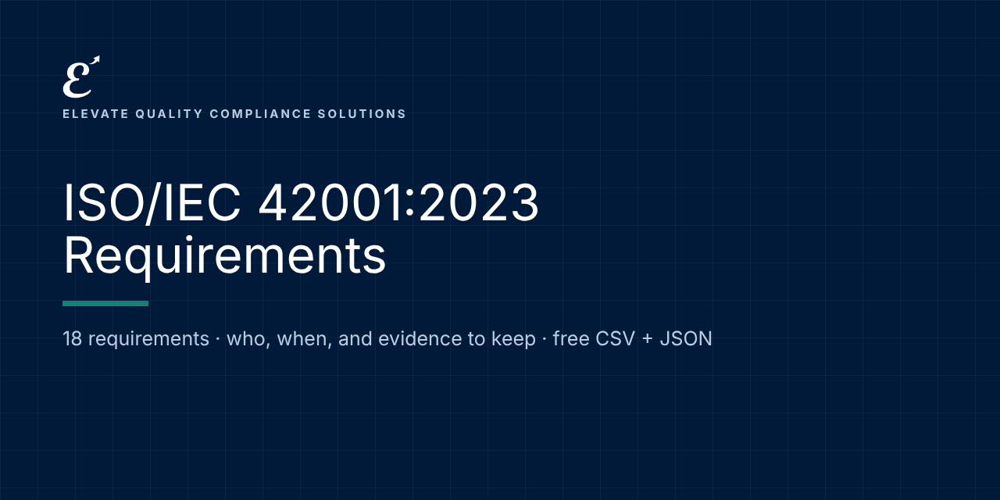

# ISO/IEC 42001:2023: Requirements and Evidence

   

**Free, machine-readable ISO/IEC 42001:2023 requirements in plain language: who each one applies to, when it applies, and examples of the evidence to keep.** CSV and JSON, ready for Excel, Google Sheets, GRC tools or your own code.

Maintained by [Elevate Quality Compliance Solutions](https://elevateqcs.com). If this saves you time, please ⭐ star the repo so others can find it.

**Source:** ISO/IEC 42001:2023 Artificial intelligence: Management system. Clause and Annex A area references with our own summaries; the standard's text is copyrighted and not reproduced. Buy the standard from ISO or your national body.
**Official text:** https://www.iso.org/standard/81230.html

## Key dates
| Date | What applies |
|---|---|
| 2023-12-18 | ISO/IEC 42001:2023 published |

## How to use it (2 minutes)
1. **Browse online:** [https://elevate-qcs.github.io/iso-42001-requirements/](https://elevate-qcs.github.io/iso-42001-requirements/) and search or filter.
2. **Spreadsheet:** download [`data/requirements.csv`](data/requirements.csv), open it in Excel or Google Sheets, and add columns for status, owner and evidence location. That's your gap assessment.
3. **Code and GRC tools:** load [`data/requirements.json`](data/requirements.json) (format: [`schema/`](schema/requirement.schema.json); examples: [`examples/`](examples/)).

Full guide: [docs/HOW-TO-USE.md](docs/HOW-TO-USE.md) · [FAQ](docs/FAQ.md)

## Requirements (18)
Applies to: all

| Reference | Requirement | Applies to | From | Evidence examples |
|---|---|---|---|---|
| 4 | **Context of the organization**: Understand internal and external issues, interested parties; define the AI management system scope and your AI roles. | all | Voluntary (certifiable) | Context and interested-party register; scope statement; AI role statement. |
| 5 | **Leadership**: Top management commitment, an AI policy, and assigned roles and responsibilities. | all | Voluntary (certifiable) | Approved AI policy; RACI; management communications. |
| 6.1 | **Actions to address risks and opportunities**: Plan AI risk assessment, AI risk treatment (with a Statement of Applicability against Annex A) and AI system impact assessment. | all | Voluntary (certifiable) | Risk criteria; risk assessment; Statement of Applicability; impact assessments. |
| 6.2 | **AI objectives**: Set measurable AI objectives and plans to achieve them. | all | Voluntary (certifiable) | Objectives with targets and owners. |
| 6.3 | **Planning of changes**: Plan changes to the management system in a controlled way. | all | Voluntary (certifiable) | Change records. |
| 7 | **Support**: Resources, competence, awareness, communication and documented information. | all | Voluntary (certifiable) | Competence records; awareness training; document control. |
| 8 | **Operation**: Operate planned processes; perform AI risk assessments, risk treatment and impact assessments at planned intervals and on change. | all | Voluntary (certifiable) | Operational records; updated assessments; treatment status. |
| 9 | **Performance evaluation**: Monitoring and measurement, internal audit and management review. | all | Voluntary (certifiable) | Metrics; audit program and reports; review minutes. |
| 10 | **Improvement**: Continual improvement, nonconformity and corrective action. | all | Voluntary (certifiable) | Corrective action records; improvement log. |
| A.2 | **Policies related to AI (Annex A area)**: Controls on documenting and reviewing AI policy and its alignment with other policies. | all | Voluntary (certifiable) | AI policy; review records. |
| A.3 | **Internal organization (Annex A area)**: Controls on roles, responsibilities and reporting of concerns. | all | Voluntary (certifiable) | Role definitions; concern reporting process. |
| A.4 | **Resources for AI systems (Annex A area)**: Controls on documenting data, tooling, system, computing and human resources. | all | Voluntary (certifiable) | Resource inventories. |
| A.5 | **Assessing impacts of AI systems (Annex A area)**: Controls on impact assessment process and documentation for individuals, groups and society. | all | Voluntary (certifiable) | Impact assessment procedure and results. |
| A.6 | **AI system life cycle (Annex A area)**: Controls on objectives for responsible development, design, verification, deployment, operation, monitoring and technical documentation. | all | Voluntary (certifiable) | Life cycle procedures; verification and validation records; technical documentation. |
| A.7 | **Data for AI systems (Annex A area)**: Controls on data acquisition, quality, provenance and preparation. | all | Voluntary (certifiable) | Data sheets; data quality and provenance records. |
| A.8 | **Information for interested parties (Annex A area)**: Controls on system documentation for users, external reporting and incident communication. | all | Voluntary (certifiable) | User information; incident communication records. |
| A.9 | **Use of AI systems (Annex A area)**: Controls on processes and objectives for responsible use and intended use. | all | Voluntary (certifiable) | Use procedures; acceptable use policy. |
| A.10 | **Third-party and customer relationships (Annex A area)**: Controls on allocating responsibilities and managing suppliers and customers. | all | Voluntary (certifiable) | Contracts; supplier assessments. |

## Implementation kit (launching soon)
This repository tells you **what** is required. Our ISO/IEC 42001 implementation kit gives you **ready-to-adapt documents** to do it: policies, procedures, forms, workbooks, a Kit Navigator and training, mapped to these requirements.
**[Join the launch list](https://elevateqcs.com/coming-soon)** to be notified.

## Disclaimer
This repository is general information to help you understand and organize work on AI governance frameworks. It is not legal advice and does not guarantee compliance, certification or any regulatory outcome. Requirements are summarized in our own words; always check the official texts and get qualified advice for your situation. ISO and IEC standards are copyrighted: we reference clause numbers with our own summaries and never reproduce their text. Buy the standard from ISO, IEC or your national standards body.

## Corrections and contributions
Spotted an error or a change? [Open a correction](../../issues/new?template=correction.md) with a link to the official source. See [CONTRIBUTING.md](CONTRIBUTING.md).

## Reuse and citation
Free under [CC BY 4.0](LICENSE), including commercially, with credit: *"ISO/IEC 42001:2023 Requirements by Elevate Quality Compliance Solutions (elevateqcs.com)"*. See [CITATION.cff](CITATION.cff).

## More open requirements from ElevateQCS
[ISO 9001:2026](https://github.com/elevate-qcs/iso-9001-2026-requirements) · [ISO 14001:2026](https://github.com/elevate-qcs/iso-14001-2026-requirements) · [ISO/IEC 27001:2022](https://github.com/elevate-qcs/iso-27001-2022-requirements) · [NIS2](https://github.com/elevate-qcs/nis2-requirements) · [DORA (Financial Entities)](https://github.com/elevate-qcs/dora-financial-entities-requirements) · [DORA (ICT Providers)](https://github.com/elevate-qcs/dora-ict-providers-requirements) · [EU AI Act](https://github.com/elevate-qcs/eu-ai-act-requirements) · [NIST AI RMF](https://github.com/elevate-qcs/nist-ai-rmf-requirements) · [GDPR for AI](https://github.com/elevate-qcs/gdpr-ai-requirements)
